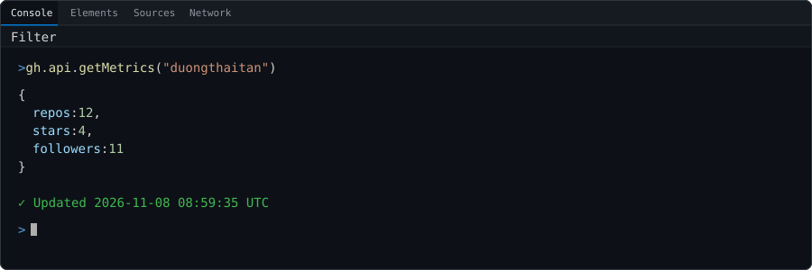

  

  
  
  
  
  
  

### About

Full-stack developer focused on production-grade web applications and cloud infrastructure. I treat software as a craft: clean architecture, thorough testing and careful design over quick fixes.

Right now I ship TypeScript across the stack, from React frontends to Node.js services backed by PostgreSQL, deployed on AWS. I build systems that are meant to scale and meant to be maintained.

### Toolkit

Click either board to press the keys for real.

### Selected work

<code>ls -l ~/projects</code>

| Project | What it is | Stack |
|---------|------------|-------|
| **3D interactive portfolio** | WebGL-powered portfolio with real-time 3D rendering | `Three.js` `React` `GLSL` |
| **Enterprise platform** | Full-stack SaaS platform with multi-tenant architecture | `Next.js` `NestJS` `PostgreSQL` |
| **AI research suite** | ML pipeline orchestration with model training dashboards | `Python` `FastAPI` `PyTorch` |
| **Open source tools** | Developer utilities and CLI tools for workflow automation | `Node.js` `Go` `GitHub Actions` |

### Certificates

<code>cat certificates.json | jq '.[]'</code>

| Certificate | Issuer | Credential |
|-------------|--------|------------|
| Meta Front-End Developer Professional | Meta | [`cert/4tv2o`](https://www.coursera.org/account/accomplishments/professional-cert/4tv2o) |
| Google Cloud Digital Leader | Google | [`cert/d0gj4`](https://www.coursera.org/account/accomplishments/professional-cert/d0gj4) |
| IBM Full Stack Software Developer | IBM | [`cert/kj7vr`](https://www.coursera.org/account/accomplishments/professional-cert/kj7vr) |
| AWS Cloud Solutions Architect | Amazon | [`CT-11PGKZIX`](https://www.credly.com/badges/CT-11PGKZIX) |
| Deep Learning Specialization | DeepLearning.AI | [`CC-USOBZSX7`](https://www.coursera.org/account/accomplishments/specialization/CC-USOBZSX7) |

### Automation

This profile maintains itself. Every visual on the page is an SVG generated from one set of design tokens, and GitHub Actions keeps the numbers current. Click the terminal to watch the runs.

<code>cat .github/workflows/*.yml</code> &nbsp;how the pipeline works

1. **Fetch live metrics** from the GitHub API: public repos, stars and followers.
2. **Render the panel** at the bottom of this page with `scripts/render-metrics.mjs`.
3. **Check every asset.** The test suite rejects scripts, external references and motion without a `prefers-reduced-motion` fallback, and fails if a committed asset drifts from its generator.
4. **Push atomically.** The metrics file updates only when its content changed and the remote SHA still matches.

Artwork comes from `scripts/gen-profile.mjs` and the interactive page from `scripts/gen-site.mjs`, both reading the same facts from `scripts/profile-data.mjs`, with the palette, type and easing curves in `scripts/svg-kit.mjs`. No external image services, no third-party actions.

### Connect

  
  
  

 

  

Icons: <a href="https://phosphoricons.com">Phosphor</a> (MIT). Tool logos: <a href="https://simpleicons.org">Simple Icons</a> (CC0); trademarks belong to their owners.
